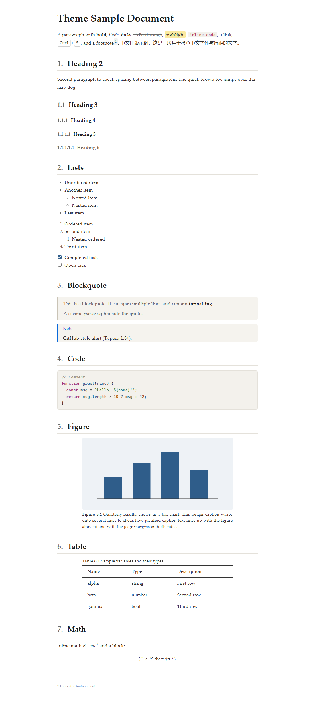

# Simple Academic

A clean, paper-like theme for [Typora](https://typora.io) built for academic writing: Palatino typography, numbered headings, three-line tables, and automatically numbered figure and table captions.



## Features

- **Palatino typography** for headings and body text on a white page, with comfortable line height and slight letter spacing. Chinese text falls back to Microsoft YaHei / PingFang SC.
- **Numbered headings** starting at H2: `1.`, `1.1`, `1.1.1`, … (H1 is the document title and restarts the numbering).
- **Three-line tables** (booktabs style): a thick top and bottom rule, a thin rule under the header, no vertical lines.
- **Automatic captions** for figures and tables, numbered per section: **Figure 2.1**, **Table 3.2**, …
- **Compact lists**: tighter spacing inside lists than between paragraphs.
- Print / PDF export friendly.

## Installation

1. Download [`simple-academic.css`](simple-academic.css).
2. In Typora, open **File → Preferences → Appearance → Open Theme Folder**.
3. Copy `simple-academic.css` into that folder.
4. Restart Typora, then select **Themes → Simple Academic**.

## Usage

### Headings

Use `#` (H1) for the document title. Section numbering starts at `##` (H2) and nests down to H6.

Numbers are added by the theme, so do not type them yourself. They appear in the document, not in the sidebar outline.

### Figure and table captions

Typora has no caption syntax, so the theme uses a simple convention: **a paragraph written entirely in italics becomes a caption** when it is placed

- directly **after** an image → figure caption, shown below the figure;
- directly **before** a table → table caption, shown above the table.

```markdown


*Quarterly results, shown as a bar chart.*


*Sample variables and their types.*

| Name  | Type   |
| ----- | ------ |
| alpha | string |
```

Inside section 1, this renders as "**Figure 1.1** Quarterly results, shown as a bar chart." and "**Table 1.1** Sample variables and their types."

- Captions are numbered within each H2 section (`<section>.<n>`). Figures and tables are counted separately.
- A captioned figure or table and its caption share the same width (75% of the page by default), and the caption text is justified, so both edges line up.
- Leave a blank line between the image and its caption; otherwise Markdown merges them into one paragraph.
- Leave captioned images at 100% zoom in Typora. Typora's image zoom is applied on top of the theme's width, so the image would no longer match its caption.

## Customization

All main settings are CSS variables at the top of `simple-academic.css`:

| Variable | Default | Controls |
| --- | --- | --- |
| `--bg-color` | `#ffffff` | Page background |
| `--text-color` | `#333333` | Body text color |
| `--body-font` / `--heading-font` | Palatino Linotype, … | Font stacks |
| `--body-size` | `1rem` (16px) | Body text size |
| `--letter-spacing` | `0.02em` | Letter spacing |
| `--line-height` | `1.75` | Paragraph line height |
| `--list-line-height` | `1.5` | Line height inside lists |
| `--table-rule-thick` / `--table-rule-thin` | `1.5px` / `0.75px` | Three-line table rules |
| `--figure-label` / `--table-label` | `"Figure"` / `"Table"` | Caption labels (e.g. `"图"` / `"表"` for Chinese) |
| `--captioned-width` | `75%` | Width of captioned figures, tables and their captions |
| `--caption-gap` | `0.3rem` | Space between a caption and its figure/table |

After editing, switch to another theme and back (or restart Typora) to reload.

## Compatibility

- Requires a recent Typora 1.x. Captions rely on the CSS `:has()` selector.
- Works with Typora's **Indent first line of paragraphs** preference.
- Palatino Linotype ships with Windows; macOS has Palatino. Other systems fall back to Book Antiqua or a generic serif.

## Development

| Path | Purpose |
| --- | --- |
| `simple-academic.css` | The theme |
| `sample.md`, `lorem-ipsum.md` | Test documents covering every element |
| `preview.html` | Browser preview that copies Typora's DOM; loads Typora's `base.css` from the local install (`D:\Typora\...`, adjust for your system) |
| `tools/shot.ps1` | Takes a screenshot of `preview.html` with headless Edge (Windows) |
| `tools/deploy.ps1` | Copies the theme into Typora's theme folder |
