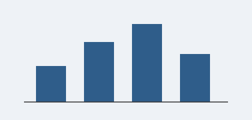

# Theme Sample Document

A paragraph with **bold**, *italic*, ***both***, ~~strikethrough~~, ==highlight==, `inline code`, a [link](https://typora.io), <kbd>Ctrl</kbd>+<kbd>S</kbd>, and a footnote[^1].

## Heading 2

Second paragraph to check spacing between paragraphs. The quick brown fox jumps over the lazy dog.

A longer paragraph follows to judge the measure. Most of a paper is running text like this, so the line length, the leading and the colour of the type matter more than any ornament: a reader should be able to follow a line to its end and find the start of the next one without effort, for page after page.

中文段落用于检查宋体与西文衬线字体的搭配。学术写作中，正文通常采用首行缩进而不加段间距，标题编号悬挂于版心之外，使所有文字共享同一条左边线。This sentence mixes in Latin text and figures such as 2026 and 3.14.

### Heading 3

#### Heading 4

##### Heading 5

###### Heading 6

## Lists

- Unordered item
- Another item
  - Nested item
  - Nested item
- Last item

1. Ordered item
2. Second item
   1. Nested ordered
3. Third item

- [ ] Completed task
- [ ] Open task

## Blockquote

> This is a blockquote. It can span multiple lines and contain **formatting**.
>
> A second paragraph inside the quote.

> [!NOTE]
> GitHub-style alert (Typora 1.8+).

## Code

```javascript
// Comment
function greet(name) {
  const msg = `Hello, ${name}!`;
  return msg.length > 10 ? msg : 42;
}
```

## Figure



*Quarterly results, shown as a bar chart. This longer caption wraps onto several lines to show how justified caption text lines up with both edges of the figure.*

## Table

*Sample variables and their types.*

| Name  | Type   | Description |
| ----- | ------ | :---------: |
| alpha | string |  First row  |
| beta  | number | Second row  |
| gamma | bool   |  Third row  |

## Math


*This is a figure.*

Inline math $E = mc^2$ and a block:
$$
\int_0^\infty e^{-x^2}\,dx = \frac{\sqrt{\pi}}{2}
$$

---

[^1]: This is the footnote text.
